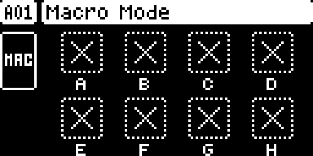
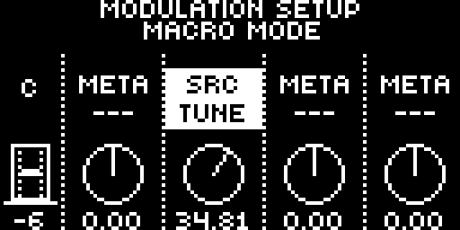

# Macro Mode

A Digitakt II module by @toonst. Version 0.1.0-experimental, for OS 1.17 on the Digitakt II base (core 1.1).

## Overview

Hold PAGE and press MOD, and encoders A–H become eight performance macros. Each macro moves up to four sound parameters, chosen from a list like the stock modulation setup's, each with its own depth and on the tracks you choose. The macros ride on top of the sound the way the stock modulators do: the module adds its offsets to every track's parameter values once a frame, before the LFOs add theirs, held in each parameter's range. The kit itself never changes, so a macro cannot be recorded or locked, and turning it back to the centre leaves the sound exactly as saved. This is especially useful when the Digitakt II plays as an MPE sound module or live, with one knob sweeping several parameters on several tracks at once.

A project has one macro setup. It is saved inside the project file with the knobs' positions and comes back when the project is loaded.

## Controls

**Macro page** (hold PAGE and press MOD, or MOD and then PAGE; MOD lights blue):

| Do this | And |
| --- | --- |
| Turn encoders A–H | Move that macro, −64 … +63. A macro with no parameter yet shows the MIDI pages' mark for a free knob |
| Turn LEVEL/DATA | Move all eight macros together |
| FUNC + NO, or push LEVEL/DATA | All macros back to the centre |
| FUNC + push an encoder | Open that macro's setup |
| FUNC + push and hold an encoder | Name the macro |
| MOD, or another page key | Leave macro mode |

**Setup** (FUNC + push an encoder on the macro page):

| Do this | And |
| --- | --- |
| Encoders A–D | Choose what parameters 1–4 control, from a list like the stock modulation setup's |
| Encoders E–H | How far each one moves (its depth, positive or negative, in the stock depth format) |
| LEFT / RIGHT | Select one of the four parameters |
| Trig keys | Choose the tracks the selected parameter acts on (lit red) |
| NO or MOD | Back to the macro page |

## Usage

Set up one macro, then play it. The screens are under [Screens and audio](#screens-and-audio).

### Quick tutorial

1. Hold PAGE and press MOD: the macro page opens and MOD lights blue.
2. Hold FUNC and push encoder A: the setup of macro A opens.
3. Turn encoder A to choose FLTR FREQ, and encoder E to set its depth, for example +64.00.
4. Press the trig keys of the tracks it should act on; they light red.
5. Press NO, then turn encoder A: the filter opens and closes on those tracks, and the kit stays as saved.

Macro mode works as a page: the keys it does not use keep their stock function, and menus, popups and mute mode come over the macro page while the mode stays on. TRK + trig keeps the mode. Save the project to keep a setup: SAVE PROJECT AS writes it, LOAD PROJECT brings it back.

## Compatibility and limitations

- **Needs the Digitakt II base (core 1.1)**: `ev_frame_params` for the per-frame values, `ev_key_leds` for its LEDs and `core_projdata` for the setup. It patches no stock site of its own.
- **Takes PAGE + MOD and the macro page** (`ui:PAGE + MOD`, `ui:macro mode`). Stock does nothing with that combination; everything else reaches the stock OS as before.
- **One setup per project.** Every pattern and kit of a project shares it. The setup takes 192 of the 484 bytes of the project header's gap (`projdata:MMP2`). The module keeps no kit data, so a kit record's 191 bytes stay free for other modules, and it writes nothing else to the card.
- **CREATE NEW keeps the setup that was on**, with the knobs where they were; LOAD PROJECT brings the loaded project's own (seen in the emulator).
- **Projects stay safe.** A project saved with macro mode opens on the stock OS, without macros, and the stock OS keeps the setup when it saves the project again. A project from the stock OS opens without a setup. If something else has already put data in the header's gap, the base leaves it alone and macro mode starts without a setup.
- **Load.** The work in the frame interrupt grows with the setup: nothing to speak of with no macro turned, and about a quarter more instructions than the stock interrupt runs with all eight macros on four destinations and sixteen tracks each ([TESTING.md](TESTING.md)). Counted in the emulator, not timed on a unit.
- **Not offered as destinations yet:** machine-specific parameters and the LFOs.
- digi_macro's own build can also keep a setup per kit. Those per-kit setups are not read here, nor are setups from digi_macro builds before 0.1.

## Tests and measurements

See [TESTING.md](TESTING.md). In short: the package in Modwerk's catalogue, built from this folder with the reviewed toolchain and linked on the Digitakt II base by the site's builder, passed digi_macro's emulator scenarios for this build in digikit's emulator on OS 1.17: the macro page, the setup, the per-frame values and the LEDs; SAVE PROJECT AS and LOAD PROJECT; and round trips of the project file through the stock OS. Results on a unit are in TESTING.md, each with the build it was seen on.

## Authorship and licences

Macro mode is toonst's, from [toonst/digi_macro](https://github.com/toonst/digi_macro) at `62f0b0a`, built there with `MM_KITS=project`, under GPL-2.0-or-later ([LICENSE](LICENSE)); its own README is in [upstream/](upstream/README.md). It runs on the Digitakt II base, which starts from irpina's core-dt2 (elekloader, GPL-2.0-or-later) with toonst's 1.1 additions and Claptom-music's sequencer hooks. The firmware locations in `src/mm_os.h` are addresses only. This folder holds no firmware bytes.

## Screens and audio

Both are captures of the build TESTING.md describes, in digikit's emulator ([capture record](media/capture.json)). The module makes no sound of its own: it moves the parameters of the stock sound.
